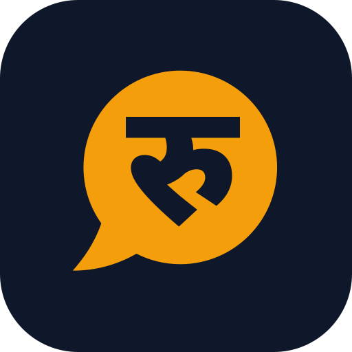

# Design system

Generated with the **UI/UX Pro Max** skill (`--design-system "fintech payment notification utility
trustworthy"`), then adapted for Android / Material 3 and Devanagari.

| | Choice | Why |
|---|---|---|
| Pattern | Trust & authority | Money app for shopkeepers: calm, legible, no gimmicks |
| Style | Minimalism / Swiss | High contrast, grid, bordered cards, few accents |
| Primary | Gold `#F59E0B` on ink `#0F172A` | "Gold trust": evokes coins, reads well on both themes |
| Text gold | `#FBBF24` dark / `#B45309` light | Gold as *text* must hit 4.5:1; raw `#F59E0B` on white fails |
| Credit / debit | Green `#4ADE80`/`#15803D`, red `#F87171`/`#B91C1C` | Always paired with an arrow icon and a +/− sign, so colour is never the only cue |
| Type (EN) | IBM Plex Sans | Design-system pick for finance |
| Type (NE) | Noto Sans Devanagari, +12% line height | No Devanagari pairing in the skill DB (fallback); full conjunct support; matras need room |
| Numbers | Tabular figures, lakh/crore grouping, Devanagari digits in Nepali | Amounts align in lists; matches how Nepal reads money |
| Spacing | 4/8 dp scale (`Spacing`) | Consistent rhythm |
| Motion | 150 / 260 / 420 ms (`Motion`), exits faster than entrances | Off entirely when Android "remove animations" is on |
| Avoided | Purple/pink AI gradients, emoji icons, playful styling | Skill anti-patterns for fintech |

Tokens live in `app/src/main/java/.../ui/theme/`. Screens use only `MaterialTheme.colorScheme`
and `LocalPaisaColors`, with no raw hex.

## Logo

A speech bubble saying **रु**: the price-tag abbreviation every Nepali shopkeeper reads daily,
coming out of a phone's mouth. One flat shape, so it survives a 24 dp status-bar icon and a
themed (monochrome) launcher icon. The letter is Noto Sans Devanagari ExtraBold, outlined and
cut out of the bubble, so the hole shows whatever is behind it. The tail is drawn with curves,
not a triangle, so it reads as hand-cut paper rather than a chat-app glyph.

| File | Use |
|---|---|
| `docs/brand/mark.svg` | The mark alone (gold) |
| `docs/brand/icon.svg`, `icon-512.png` | Store / README icon |
| `docs/brand/banner.svg`, `banner.png` | README and social preview (1280×640, text outlined) |
| `res/drawable/ic_launcher_foreground.xml`, `ic_launcher_monochrome.xml` | Adaptive + themed icon (inside the 66 dp safe zone) |
| `res/drawable/ic_stat_listening.xml` | Status-bar icon |
| `res/drawable/ic_brand_mark.xml` | In-app hero on the welcome screen |

## Pre-delivery checklist (from the skill's `pro-rules.md`)

- [x] Vector icons from one family (Material Symbols *Rounded*); no emoji
- [x] Touch targets ≥ 48 dp; primary buttons 56 dp
- [x] Light and dark schemes defined separately; text ≥ 4.5:1
- [x] Edge-to-edge with safe-drawing insets
- [x] Decorative icons hidden from TalkBack; rows have full content descriptions; headings marked
- [x] Reduced motion respected (hero rings, live dot, screen transitions)
- [ ] Verify on a small phone, a tablet, and at the largest font size (needs a device)
